<!-- Generated by tools/build.mjs. Edit that file, not this one. -->

<a href="https://vntechies.dev"></a>

<a href="https://vntechies.dev/career">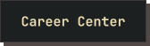</a>

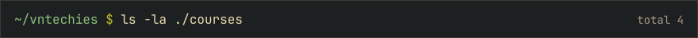

<a href="https://vntechies.dev/courses/aws/saa/gioi-thieu">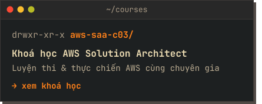</a><a href="https://vntechies.dev/courses/devops/gioi-thieu">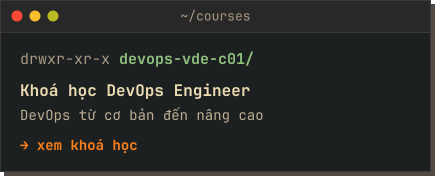</a>
 
<a href="https://vntechies.dev/courses/data-engineer-bootcamp/gioi-thieu">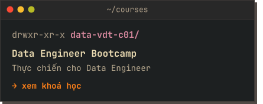</a><a href="https://vntechies.dev/courses/aws/dea/gioi-thieu">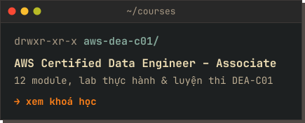</a>

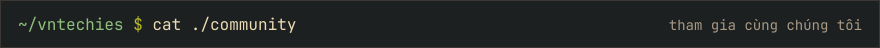

<a href="https://www.youtube.com/@vntechies">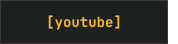</a><a href="https://facebook.com/vntechies">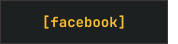</a><a href="https://discord.com/invite/YecagKUqpS">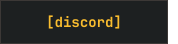</a><a href="https://linkedin.com/company/vntechies">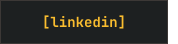</a><a href="https://www.tiktok.com/@vntechies">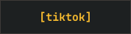</a>

